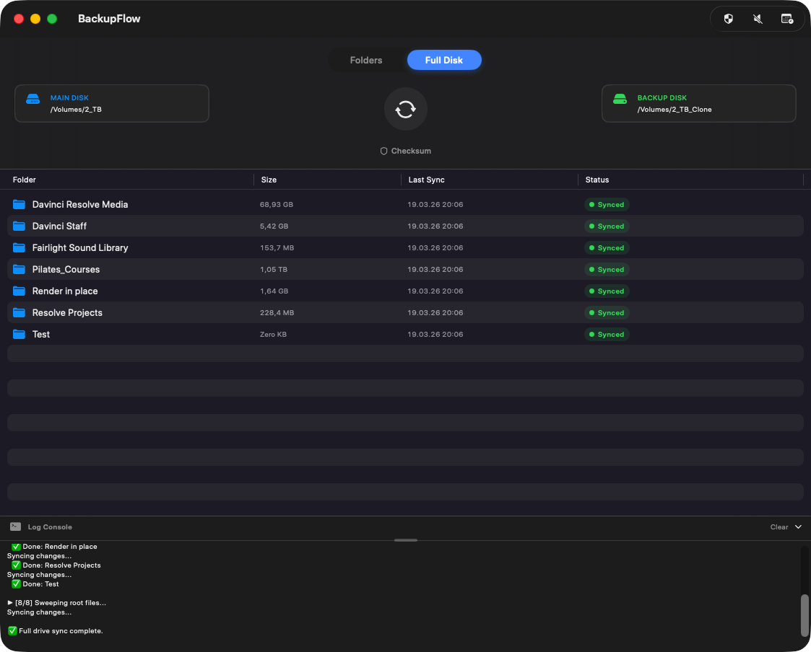

<h1 align="center">BackupFlow</h1>
<p align="center">
  
</p>

<p align="center">
  
  
  
  
</p>

<p align="center">
  <b>A native, menu-bar-first synchronization and backup tool for macOS.</b><br>
  Built with SwiftUI, powered by the system <code>rsync</code>, and designed for professional workflows.
</p>

---

## 🚀 Overview

**BackupFlow** is a lightweight, background-focused macOS utility that keeps your critical folders or entire disks mirrored to a backup drive. It is built for people who work with large files (video editors, developers, audio engineers). It wraps the proven reliability of `rsync` in an unobtrusive SwiftUI interface.

BackupFlow lives in your menu bar. It runs scheduled or manual syncs without getting in your way, and it never touches the network.

> **BackupFlow mirrors.** The backup becomes an exact copy of the source: files you delete on the Main disk are deleted from the Backup disk too. It is not a versioned backup like Time Machine. See [Safety](#safety) for the checks that stop a mirror from destroying data.

---

## ✨ Features

### Syncing
- **📁 Custom Folders** — pick specific folders on the Main disk to back up, each with its own progress bar and live size.
- **💽 Full Disk** — mirror an entire volume. Each top-level folder is synced as its own task, then a final pass picks up the files and folders at the disk root.
- **⏱ Scheduling** — automatic syncs from every 15 minutes up to weekly, while the app is running. Scheduled runs never stop to wait for input.
- **🔬 Checksum mode** — compares file contents instead of size and modification date. More thorough, but much slower.
- **📊 Honest progress** — a byte-weighted progress ring based on the bytes actually transferred, plus per-folder bars.

### Safety
- **🛡️ Deletion Guard** (optional, off by default) — before anything is deleted from the backup, shows each file that would be removed and asks you to confirm. "Apply to all" approves the rest. Rejecting a file stops the sync and removes only the files you already approved. A scheduled sync never waits for an answer that nobody may be there to give. Folders whose deletions need review are skipped, and a notification asks you to run Sync manually.
- **🚨 Mass-deletion block** (always on) — if a sync would empty the backup, or delete more than half of it (100+ items), BackupFlow skips that folder and tells you, even with Deletion Guard off. This catches the classic mirror disaster of syncing from the wrong or an empty disk.
- **💽 Disk identity checks** — disks are tracked by volume UUID, not just by name. BackupFlow refuses to sync if a different disk appears where a selected one used to be, if it can't read the disk's identity, or if Main and Backup are the same physical disk.
- **💾 Storage guard** — checks free space on the backup disk before syncing (estimated transfer + 500 MB margin) and alerts you with a macOS notification if it won't fit.
- **🔌 Disk detection** — notices when disks are ejected or reconnected, stops a running sync if a disk disappears, and restores your setup when the same disk returns.

### Everyday use
- **🔍 Log console** — absolute paths for every file copied, every deletion and every error, with per-folder results (e.g. `✅ Done: DaVinci Resolve Media`). The log is also written to a file, so an interrupted sync can be diagnosed later.
- **🧹 Clean backups** — macOS and Windows metadata (`.DS_Store`, `._*`, `.Spotlight-V100`, `.Trashes`, `.fseventsd`, `Thumbs.db`, …) is never copied.
- **🔒 Private by design** — App Sandbox, security-scoped bookmarks, zero network requests, zero telemetry. See [PRIVACY.md](PRIVACY.md).

---

## 🛠 How It Works

BackupFlow drives the `rsync` that ships with macOS. On macOS 15 this is Apple's **openrsync** (protocol 29, compatible with rsync 2.6.9).

Every sync runs in phases:

1. **Preview.** For each folder, BackupFlow does a single dry run (`rsync -n -i --stats`). It reports how many bytes will be transferred, exactly which files would be deleted, and how many items the source holds. If a preview fails, that folder is skipped rather than synced blind.
2. **Checks.** The storage guard compares the total against free space. Then, folder by folder, the deletions from the preview go through the mass-deletion block and, if enabled, the Deletion Guard.
3. **Transfer.** The real `rsync` runs per folder. BackupFlow streams its output to update the log and the progress ring.
4. **Root sweep** (Full Disk only). A final pass mirrors whatever lies outside the folders already synced: files at the disk root, hidden top-level folders, and top-level folders that exist only on the backup. The folders synced in step 3 are excluded, so the sweep doesn't walk the whole disk again. It gets its own preview and the same deletion checks.

A folder is marked **Synced** only when rsync finishes. A run where some files couldn't be copied (rsync exit code 23, e.g. permission denied) is reported as a warning rather than a silent success.

**rsync flags:**

```
-av --delete --no-perms --no-owner --no-group --progress
--exclude=.DS_Store --exclude=._* --exclude=.Spotlight-V100 --exclude=.Trashes
--exclude=.fseventsd --exclude=.DocumentRevisions-V100 --exclude=.TemporaryItems
--exclude=$RECYCLE.BIN --exclude=.localized --exclude=Thumbs.db
```

`--checksum` is added in Checksum mode. Two flags are deliberately **not** used, because both caused real failures under App Sandbox with openrsync:

- `--extended-attributes` — fails on every file with `copyfile: Operation not permitted`.
- `--delete-excluded` — crashes openrsync when it walks the system folders at a volume root.

The details are in the comment above `baseFlags` in [`SyncEngine.swift`](Sources/BackupFlow/Services/SyncEngine.swift).

---

## 📖 Usage

1. **Launch** — click the BackupFlow icon in the menu bar.
2. **Select drives** — click the left card for the **Main Disk** (source) and the right card for the **Backup Disk** (destination). They must be two different physical disks.
3. **Choose a mode** — **Folders** (then add folders from the Main disk) or **Full Disk**.
4. **Optional:**
   - turn on **Deletion Guard** (shield icon) to review every deletion;
   - turn on **Checksum** for a content-level comparison;
   - set up the **scheduler** (calendar icon).
5. **Sync** — press the circular Sync button and follow the progress in the log console.

---

## 🖥 Building from Source

### Requirements
- macOS 15.0 (Sequoia) or newer.
- Xcode 26 or newer (Swift 6.2+ toolchain).

### Build and run the app
```bash
git clone https://github.com/antonsb13/BackupFlow.git
cd BackupFlow
open BackupFlow.xcodeproj
```
In **Xcode → Project Settings → Signing & Capabilities**:
- Select your **Apple Developer Team**.
- Make sure **App Sandbox** is enabled, with **User Selected File** set to `Read/Write`.

Press `Cmd + R` to build and run.

### For contributors
The project has two build systems:

| | Use for | Notes |
|---|---|---|
| `BackupFlow.xcodeproj` | the real, signed `.app` | entitlements, `Info.plist`, assets, App Sandbox |
| `Package.swift` (SPM) | fast builds and **all tests** | builds a bare executable, without the app bundle |

```bash
swift build          # quick compile
swift test           # run the XCTest suite (the only way to run tests)
```

- **No test target in the Xcode scheme.** `xcodebuild test` does not work, so use `swift test`.
- **New source files must be added to the Xcode target.** SPM picks up a new `.swift` file in `Sources/BackupFlow/` automatically, but the `.app` only includes files added to the `BackupFlow` target in Xcode.
- **iCloud-synced folders break `swift build`.** If the clone lives in an iCloud-synced folder (such as `~/Documents`), the build can fail with `resource fork, Finder information, or similar detritus not allowed`. Use a build folder outside iCloud:
  ```bash
  swift build --scratch-path ~/Library/Caches/BackupFlow-spm
  swift test  --scratch-path ~/Library/Caches/BackupFlow-spm
  ```

---

## 🗂 Where BackupFlow Keeps Its Data

Everything stays on your Mac, inside the app's sandbox container (`~/Library/Containers/com.backupflow.app/`):

- **Settings, drive bookmarks and sync history** — `UserDefaults`.
- **Sync log** — `Data/Library/Logs/BackupFlow/backupflow.log`. It rotates at 2 MB and keeps one previous file. It contains the paths of synced files and can be deleted at any time.

---

## 📝 Changelog

### v1.8.5 — November 2026
- **Deletion Guard fixes** — it no longer misses files with Cyrillic and other non-ASCII names, or names containing `*`. It also no longer shows copied files as deletions. A failed preview now skips the folder instead of letting `rsync --delete` run unconfirmed.
- **Full Disk root sweep** — now covered by the Deletion Guard.
- **New: mass-deletion block** — works even with Deletion Guard off.
- **Folder selection** — folders outside the Main disk are rejected.
- **Disk checks**:
  - disk identity is re-checked right before every sync;
  - a disk whose identity can't be read is no longer trusted;
  - ejecting `Backup 2` no longer clears `Backup`.
- **Sync history** — "Last synced" dates now survive ejecting and reconnecting the same disk.
- **Faster:**
  - one dry run per folder instead of two;
  - the root sweep skips folders already synced;
  - folder sizes are calculated off the main thread;
  - the log console updates in batches.
- **Log** — correct non-ASCII file names, and the tail of rsync's output is no longer lost.
- **Scheduled syncs** — no longer hang on a deletion confirmation. Folders that need review are skipped with a notification.
- **Quitting** — waits for rsync to stop and force-kills it if needed, so no rsync is left running after the app quits.
- **Saved disk and folder access** — refreshed automatically when macOS reports it as outdated. Access failures are now reported instead of silently ignored.
- **Swift 6** — the Xcode project now builds in Swift 6 language mode with strict concurrency checking, like the Swift package.

### v1.8.1 and follow-up fixes
- **rsync exit code 23** — reported as a warning instead of a silent success.
- **Disk identity checks** by volume UUID, including blocking the same disk for both roles.
- **Mode switcher** — locked while a sync is running.
- **Honest progress ring** — the final root sweep shows an indeterminate "Finalizing" phase instead of freezing at 99%.

### v1.8.0
- Storage guard with native alerts and notifications.
- Live folder size calculation.
- UI state reset when a disk is disconnected or changed.

---

## 📄 License

MIT License — see [LICENSE](LICENSE) for details.

---
*Built with ❤️ for the macOS Creative Community. v1.8.5 — November 2026.*
